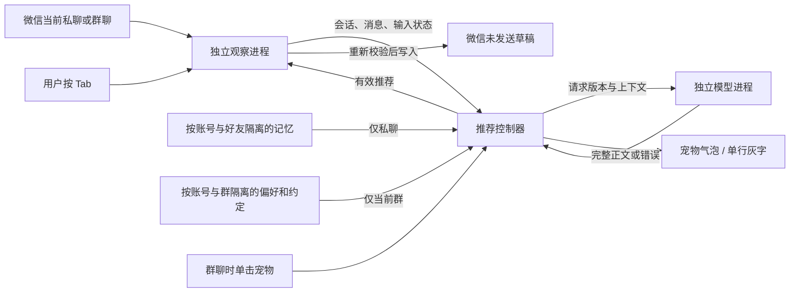

# 微信 AI 桌宠：功能与代码结构

程序为当前可读取的微信聊天提供回复草稿：私聊自动推荐，群聊由用户点击宠物生成。模型生成、显示推荐、用户采用、用户发送是不同步骤；程序只实现前三步，发送始终由用户手动完成。当前审查证据在本地 reports/；本轮合成回归不代表重新完成实机验收。

## 模块与数据流

| 模块 | 主要代码 | 职责与边界 |
|---|---|---|
| 启动与单实例 | `Program.cs`、`Runtime/SingleInstanceActivation.cs` | 同用户、同 Windows 会话一个实例；普通重复启动恢复现有宠物，后台启动不抢显示 |
| 微信观察与采用 | `Runtime/ObserverProgram.cs`、`WeChatReader.cs`、`NativeMessageReader.cs`、`QtCompositionGate.cs`、`WindowsRuntime.cs` | 构建校验、进程身份、控件读取、稳定消息标识、组词检测、草稿接口；普通 Tab 不调用发送 |
| 推荐调度 | `Runtime/Contracts.cs`、`DesktopRuntime.cs` | 私聊打开/增量触发，群聊点击触发；合并、取消、重连、结果归属、有效期与错误反馈 |
| 模型与授权 | `Runtime/ModelClient.cs`、`model-worker.mjs` | 本地进程协议、独立凭证、三种入口、取消与超时；模型没有操作电脑的工具 |
| 设置持久化 | `Runtime/RuntimeSettingsPersistence.cs` | 保存前撤销旧推荐；失败原地恢复最近成功配置并停止推荐；读失败保留原文件 |
| 聊天记忆 | `Runtime/MemoryIdentity.cs`、`MemoryStore.cs`、`PreferenceRules.cs`、`RecommendationMemory.cs` | 账号/好友/群分别隔离；好友明确偏好更新，群偏好与约定手动维护；不学习未发送草稿 |
| 宠物与设置 | `PetWindow.cs`、`PetVisuals.cs`、`PetSettingsWindow.cs`、`Runtime/*Window.cs`、`TrayIcon.cs` | 简洁展示、动画、灰字与全文、按好友编辑；窗口不承担模型调度 |
| 表情显示与填入 | `Runtime/ReplyEmoji.cs`、`NativeEmojiDraft.cs`、`NativeEmojiClipboard.cs`、`NativeEmojiPasteShortcut.cs`、`assets/wechat-pet/emoji` | 预览使用已核实微信原图；已核实名称用受保护的粘贴转换，完整双路回读后确认；未知名称保留文字 |
| 构建与安装 | `Build.ps1`、`Package.ps1`、`Package-Source.ps1`、`Installer.cs` | 按用户安装、完整预检与可捕获异常回滚、白名单打包、隔离检查；强制中断事务恢复尚缺 |

观察器临时启用微信辅助功能，守护进程恢复本程序修改的开关。文字来自控件，身份和组词使用现有原生适配，不使用 OCR；只允许已校验的微信构建。

明确的不兼容构建或机器码签名失败按进程 ID 与启动时间锁定，保留故障提示，不无限重启同一观察器。其他微信目标仍可选择；新进程重新进行完整校验。控件或消息列表的暂态失败不属于这种锁定。

## 推荐生命周期

1. 发现同一用户会话内的微信，绑定进程 ID、启动时间和主窗口。多个目标无法确定时等待选择。
2. 读取联系人、消息列表、输入框、草稿和组词状态。最小化或状态不明确时不采用推荐。私聊和群聊均验证最后一个保留行确为原始列表末行，未知或被省略的尾行不能让前一条文字成为“最新来信”。
3. 打开尚未回复的私聊，或确认新增对方文字，且输入框为空，约 600ms 合并后生成。历史滚动和普通恢复不反复触发。
4. 群聊仅在用户点击宠物时请求生成：账号、群和成员身份确认，最近快照不超过一秒，当前在底部、草稿为空且未组词，最后一条为他人的可读取文字。当前可读上下文最多 30 条、文字合计最多 8000 字符；非文字保留类型标记，空正文的历史文字不传入模型。没有群昵称时使用稳定的匿名成员标记，不推断姓名或关系。

   群端点与发言人成员分开验证。所有原生行都必须属于相同已确认账号、群和会话；仅历史空成员行可省略，不能省略真实尾消息或非空冲突成员。全部键与过滤前正文版本仍参与失效判断，省略内容不传入模型。推荐就绪判断与失败提示使用同一套原因；未确认群的点击只能显示提示，不能授权调用模型。
5. 私聊最近最多 30 条可读文字，每条最多 2000 字符、合计最多 8000；另附当前好友最多 1500 字符记忆和最多 5 条表达示例。群聊不附加这些私聊内容，只通过独立 `groupMemory` 字段传入当前账号、当前群的回复偏好与约定（400/2000 字符上限），不保存群成员的个人记忆。
6. 同时只执行一个推荐请求；新请求取消旧等待，30 秒截止，不自动切换服务。输入、会话或配置变化使旧结果失效。群新消息只撤销旧结果，需再次点击生成。
7. 对已经触发、尚未完成的那次私聊来信，短暂读取失败或同尾上下文更新后，允许重新稳定 600ms，最多恢复一次。账号、好友、消息和输入状态仍需匹配；群聊读取中断后不自动重试。
8. 宠物可见时由 `PetReplyBubble` 在实际正文宽度上测量完整文字与表情高度；只有超过折叠空间才显示“查看全文”。点击在原气泡内展开限高滚动区域，屏幕工作区不足时进一步缩小；新正文、非推荐状态和隐藏宠物会收起。显示层保留原文，展开不修改推荐控制器或采用协议。隐藏宠物时仍显示单行灰字，灰字实际宽度足以显示全部文字时不展示“查看全文”，发生省略或有换行时才展示。两个入口按各自布局判断，不用固定字数。推荐有效期 60 秒，最多 16000 字符。
9. 用户按真实 Tab 后，再核对前台、焦点、空草稿、组词、快照时效及消息/输入版本；群聊还核对账号和群身份。纯文字使用输入框接口；已核实微信表情使用临时剪贴板和单次受保护 Ctrl+V，核对两路完整正文及对象位置。失败撤销，不盲目重试、不模拟 Enter；未确认粘贴时不向迟到调用恢复旧剪贴板，状态明确报告。

## 功能范围

| 场景 | 当前行为 |
|---|---|
| 当前私聊收到文字 | 按新增消息标识触发，相同文字的新消息可区分 |
| 打开另一好友尚未回复的聊天 | 为该好友最新的对方文字生成，隔离旧推荐与记忆 |
| 当前打开的群聊 | 单击宠物才生成；群新消息不自动触发。最新非文字或身份不明时不生成 |
| 多位好友或多个群同时来信 | 只处理当前打开的聊天，不后台轮询全部会话 |
| 微信可见，用户切到别的软件 | 可继续监听；Tab 必须回到微信空输入框才采用 |
| 微信最小化 | 暂停读取；尚无可靠来信提醒来源，不显示伪造未读状态 |
| 文字形式的 emoji | 按文字结合前文处理；实际可读性取决于微信控件 |
| 贴纸、动图、语音、文件 | 不凭类型标记猜测含义；最新来信不支持时不生成 |
| 图片 | 模型协议支持图像；微信原图自动获取尚未可靠验收，安装版不自动生成图片回复 |
| 已有草稿或中文组词 | 不覆盖，状态不明时放行 Tab |
| 模型超时、额度或登录失败 | 保留错误反馈，等待新有效操作，不无限重试或切换服务 |
| 修改好友偏好或示例 | 撤销旧推荐；重新打开该私聊可用新设置生成 |

## 记忆与表达

隔离键由微信账号和稳定好友标识共同构成，显示名称不是隔离依据。回复偏好与表达示例只属于所选好友；旧版全局偏好保留为待归属内容，不自动用于所有人。

群身份使用独立的账号/群命名空间，成员标识再绑定该账号和群；群快照不赋私聊好友身份。v4 记忆文件新增独立 `Groups` 集合；v1–v3 验证后无损迁移，老文件没有群资料时保持为空，不从好友记录或显示名称推断群。旧版程序会拒绝新版本记忆，避免再次保存时丢失群字段。群的登记只保存稳定身份和名称，回复偏好与群内约定需手动保存，不学习群聊天历史或成员个人偏好。私聊接口拒绝群快照；群接口拒绝携带好友身份的快照。UI 使用“好友 / 群聊”分类及各自搜索列表，均限定当前已确认账号。

`RecommendationMemory.Fields` 在请求发出前按会话类型取值，群记忆使用专门的结构字段，私聊 `memory` 和 `styleExamples` 保持为空。模型协议继续拒绝群请求携带私聊记忆、私聊携带非空群记忆；模型服务在等待前固定请求内容。编辑并保存任一记忆后，界面通知控制器取消生成、撤销推荐和 Tab 采用状态，旧请求结果无法重新进入界面。群内约定为不可信参考数据，不可覆盖系统任务或被当成已经执行的操作。

好友设定和表达示例由用户手动维护，明确的好友自述可以自动更新。记忆来源保留 self/peer 主体；手动编辑自己的摘录不能转成好友偏好，也不能覆盖对方的相反自述。无来源的旧手动备注保留可见，确认主体前不进入推荐。

自动记忆排除无问号提问、吃饱或喝醉等即时状态；旧误学自动项重新归为近期摘录。加载时拒绝同账号重复好友、非法日期和负数消息顺序，异常文件保留且暂停使用。自动记忆使用有限规则：最新明确表达替代冲突旧偏好；近期摘录通常保留 7 天，自动明确偏好通常保留 30 天，手动或固定内容另行保留。近期摘录不能推翻较新的明确偏好。这不等于任意自然语言的完整理解，也不证明好友自述真实。

回复优先接当前话题，再按该好友偏好和示例调整措辞。无示例也采用平实口语；不把过去可能采用的 AI 安慰草稿当作用户的表达习惯，不编造本人安排、经历或承诺。私聊和群聊提示词均要求保留原消息的不确定性，不把“待确认”写成“已受阻”，不补造原因和情绪；这不保证模型完全遵循，生成质量仍需对照验收。

记忆有档案数量和文件大小双重限制。好友或群达到 500 时，为受限的新对象即时显示清理提示，不设置全局存储错误；已有资料仍可正常使用，清理后提示消退。读取损坏时保留原文件并暂停；容量或保存失败时显示错误。记忆开关、手动修改、偏好、示例、删除和清空先保存候选数据，成功后再更新可见集合；失败保留原值和编辑草稿，允许修复存储后显式重试。重复自述使用规范化文本指纹确认相同固定内容，最新表达的时间水位继续阻止迟到旧偏好恢复；不把固定信息降级为会到期的自动摘录。

## 持久化与运行恢复

外观保存使用同目录临时文件原子替换；加载失败时保留源文件并禁止用默认外观覆盖。写入失败保留当前预览，显示未保存并提供重试。模型配置、记忆和外观分别使用各自的保存确认，不把界面即时变化当作落盘成功。

填入结果使用 `FillNoticePolicy` 保留故障：已实际开始写入的纯文字失败和表情失败保留到新的输入或会话变化，永久快捷键故障保留到观察器重新启动。未开始写入的普通文字撤销不留下故障。表情剪贴板的调用标记在最后一个提前返回守卫之后设置，确认未调用时可恢复原剪贴板，已调用但结果不明时继续隔离。`ObserverShutdown` 暴露异步清理完成任务，普通退出等待观察器结束与守护恢复窗口；系统注销或主进程强杀不承诺完整等待。

隐藏宠物时，记忆窗口仅隐藏并保留未保存编辑；重新打开前同步刷新账号范围，防止短暂显示另一个账号的内容。隐藏不等于保存，显式关闭窗口仍结束编辑。记忆文字预算截断不会拆开 UTF-16 代理对；旧异常字符只在比较时修复，不直接清空存储内容或来源。

`health.json` 标注进程、本次运行标识、启动时间和程序集标识，用于排除过期记录。诊断保存失败不阻断推荐，但在模型设置显示提示，后续成功自动消除；诊断不保存异常中的路径或聊天正文。`sendActions` 固定为 0，表示程序没有发送能力，不包含用户手动发送。观察器指令只接受 `arm`、`invalidate`、`stop`；准备推荐不写入草稿，只有符合上下文条件的手动 Tab 才触发填入。旧自动回复授权指令不会被执行。

## 质量与验收要求

- 使用合成快照重放关键状态，覆盖取消、并发、恢复、重复事件、旧结果拒绝，不只检查正常路径。
- 凭证和记忆异常测试只用隔离目录与合成数据。生产凭证使用当前用户 DPAPI，不读取 DSH 或 Codex 登录文件。
- 每次交付核对源码、运行产物、安装目录与安装包；包内不含测试程序、凭证或实聊证据。诊断不记录聊天或推荐正文。
- 自动检查通过不代替实机验收。多屏 DPI、60 分钟持续运行、中文输入法与实体键盘的组合场景需单独记录。
- 最小化提醒需独立验证非 OCR 通知或未读信号，正确识别来源并去重；未通过前不启用。

本项目以这些可检查要求持续改进；不能用测试数量或外观替代长期可靠性验证。

## 构建与维护边界

素材统一保存在项目内的 `assets/wechat-pet/`。构建和图标脚本只读取项目内素材；预览及回归按可执行文件所在的 release 目录定位项目，不依赖项目名称或同级目录。源码包使用单项目目录结构，可单独解压、改名和构建。发布程序继续使用自身目录内的 assets。

正式编译只包含根目录运行入口及 Runtime 中的生产 C# 文件；回归代码位于 tests/Runtime 和 tests/PetSelfTests.cs。ReleaseBoundaryTests 直接反射检查两个正式程序集，拒绝测试入口及已移除自动回复类型。旧演示状态适配器不再保留，也不以针对旧模拟器的测试充当正式运行证据。

Build 的 Test 模式覆盖模型协议及无网络失败恢复集成，并在退出时清除所拥有的测试可执行文件。安装包核对主程序、观察器、worker 和 Node 文件指纹后打包；源码采用入口白名单，不导出实聊测试产物。两种打包均先生成临时文件，成功后替换最终包，失败清理临时文件。

安装器按当前 Windows 用户和规范目标路径进行跨进程互斥，覆盖文件提交、卸载、快捷方式及注册阶段；同线程嵌套也会拒绝。可捕获异常回滚仍与断电/强制结束分开，尚未实现持久化事务恢复。

模型与外观设置的卡片最大宽度为 418 DIP，竖滚动条出现时随视口收缩。离线布局覆盖三种模型提供方、外观展开/收起和 260/360/1600 DIP 高度，真实多屏缩放仍单独验收。

