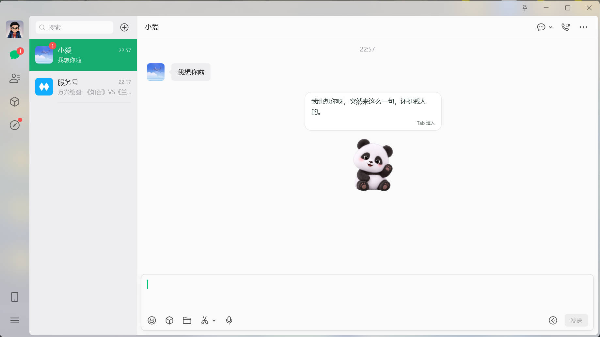
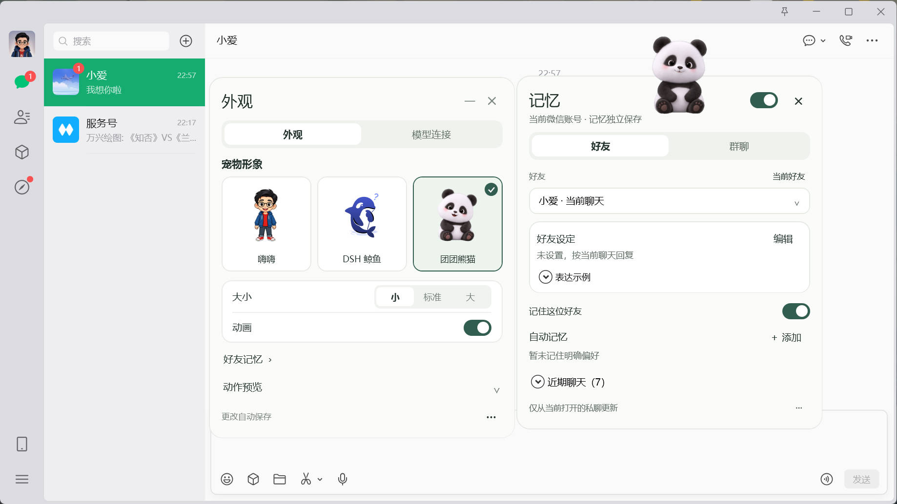
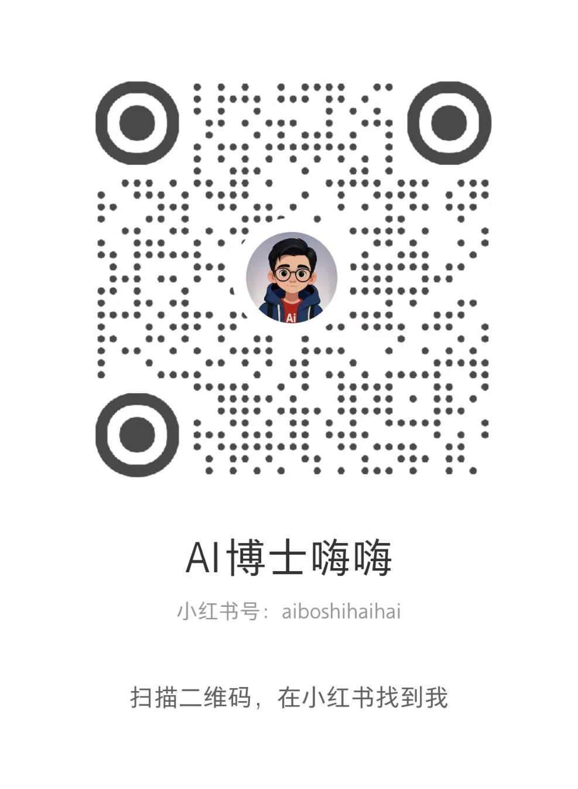

# 微信 AI 桌宠

让桌宠陪你聊微信：结合当前对话生成回复建议，按 **Tab** 填入输入框，编辑后自行发送。

[下载 Windows 安装包](https://github.com/boshihaihai/wechat-ai-pet/releases/latest) · [下载源码](https://github.com/boshihaihai/wechat-ai-pet/archive/refs/heads/main.zip) · [反馈问题](https://github.com/boshihaihai/wechat-ai-pet/issues)

## 实际使用

| 回复建议 · Tab 填入 | 外观设置 · 好友记忆 |
| :---: | :---: |
|  |  |

## 功能

- **回复建议**：私聊自动推荐，群聊单击宠物生成，长回复可展开阅读。
- **Tab 填入**：将建议写入微信输入框，发送由你决定；已有草稿或正在中文输入时不会覆盖。
- **三种形象**：嗨嗨、DSH 鲸鱼、团团熊猫，可调整大小、开关动画。
- **好友与群聊记忆**：设置关系、回复偏好和表达示例，支持查看、修改、关闭和删除。
- **多种模型连接**：支持 ChatGPT 账号、DeepSeek 账号或 DeepSeek API。
- **托盘与灰字提示**：隐藏宠物后，可在微信输入框中查看回复建议。

## 开始使用

1. 下载并运行 Windows 安装包。
2. 在桌宠设置中打开“模型连接”，选择服务并完成连接。
3. 打开微信聊天，保持输入框为空；私聊等待推荐，群聊单击宠物。
4. 按 **Tab** 填入建议，确认内容后自行发送。

更新前请从托盘退出桌宠。关闭宠物窗口会隐藏到托盘，可从托盘菜单退出。

## 使用环境与隐私

适用于 **Windows x64**，当前支持的微信版本为 **4.1.15.13**。微信更新后可能需要重新适配；微信最小化时暂停读取。

模型凭证、个人设置与好友记忆保存在当前 Windows 用户的本机目录，凭证和记忆使用系统加密。首次使用需自行连接模型；生成回复时，当前会话的相关内容会发送给你选择的模型服务。

## 联系作者

小红书：**[AI博士嗨嗨](https://xhslink.cn/o/5EYa0xpEAsq)** · 小红书号：`aiboshihaihai`

欢迎交流使用体验与建议。点击上方链接，或用小红书扫描下方二维码找到我。

## 许可

代码采用 [MIT License](LICENSE)。第三方运行时、角色与表情素材遵循 [各自许可说明](licenses/THIRD-PARTY.md)，代码许可不授予第三方素材或商标的额外权利。本项目为独立社区项目。
